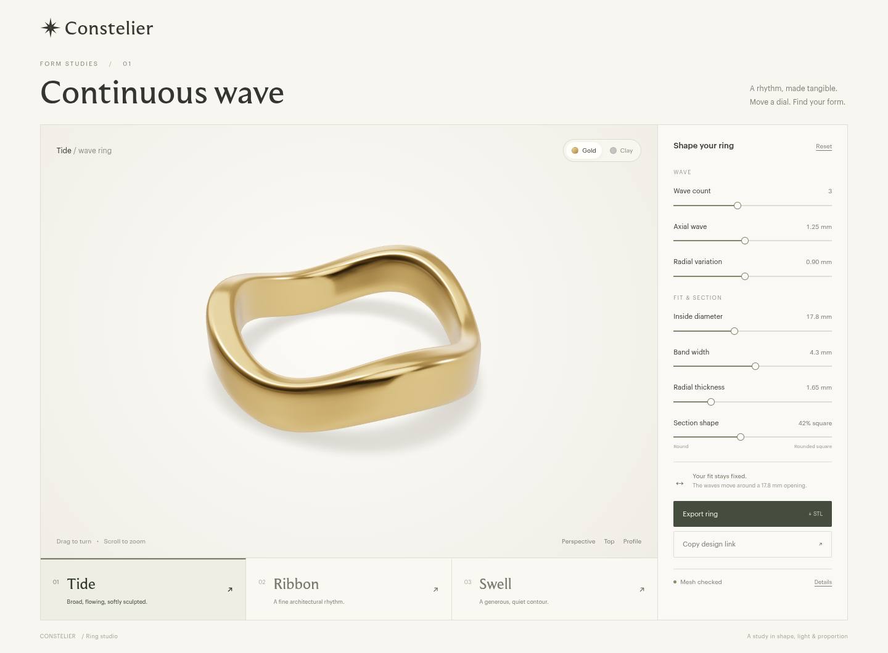

# Parametric ring studio

Branch: `prototype/ring-studio-wave`. Route: `/prototypes/rings`.
Start `npm run dev` and open that route. Production build: `npm run build`.

Three families and nine presets are integrated locally: Tide/Ribbon/Swell,
Flicker/Molten crest/Undertow, and Pinch/Flute/Chisel.
[Open the comparison gallery](rings/comparison-gallery.html). The complete local
patch remains based on `d97110085cf54ba96e77e47321ed6fc723b18005`; repository
publication and an updated deployed preview await the existing approval.
The astrology pendant and sun-arcs prototype are unchanged. No production release.



## Source and visual review status

The actual algorithm reference was inspected from
`lxrogers/generative-rings-testing` commit
`eee66e5d256c7cec17bf3d7cbaa7f966ff39dfbc`: `ring.js`, `lib.js`,
`ringGUI.js`, and `index2.js`. This implementation retains its direct indexed
cross-section-loop construction and axial/radial wave idea. It replaces the
arbitrary radius, discontinuous exterior modifier and unbounded GUI resolution
with millimetres, smooth sections and explicit budgets. No CAD booleans,
multi-ring CSG, noise, or subdivision run during dragging.

Constelier's viewer, actual `public/softbox.hdr`, and the sun-arcs source at
`97fe1f12a11f10b97583e876d529561a17f0e5d6` were read for rendering. The ring uses
its own camera, lighting and viewer; geometry is never scaled for display.

**Reference transfer to this implementation executor remains blocked.** All eight supplied Library IDs
resolved, but the current supported materialization helper returned `download
failed` for every signed transfer in this executor. No image pixels were
available locally. Library read returned captions/pointers, which are not pixel
inspection. The parent subsequently inspected these committed renders against
the original reference pixels on its own executor and found the studio visually
promising and readable. The parent owns that visual comparison; this executor
does not claim local reference-pixel inspection. No reference photos were added
to the repository.

Actual rendered screenshots were inspected and revised: the initial hard shadow
became a blurred contact shadow, the 4096×2048 HDR reflection input was capped,
and the neutral diagnostic material was darkened to reveal contours. Gold,
neutral, top, profile, close-up, extreme and mobile views were captured.
[Ribbon](rings/ribbon.png), [Swell](rings/swell.png), [Clay close-up](rings/clay.png).
The initial screenshot batch failed before upload preparation with
`hosted apps tools/list request failed: network`. A later, separately authorized
single-file handoff archive was saved successfully to Library. Generated review
images are retained here and in the handoff archives; original references are
excluded.

## Continuous-wave construction and controls

Finger axis is Y; X/Z form the ring plane. At each angular station the band
section is a convex superellipse (exponent 2–8), with independent axial width
and radial thickness. This produces real rounded edges, not a shading-only bevel.
The axial center follows an integer-period sine. Radial variation adds material
only outside the bore. The inner sample radius compensates for polygon chord
inset and includes a 0.002 mm numerical margin, preserving the requested
cylindrical clearance over triangle interiors as well as vertices.

| Control | Domain |
|---|---|
| Inside diameter | 14–24 mm, 0.1 mm increments |
| Band width | 1.4–7 mm, 0.1 mm increments |
| Radial thickness | 1.2–3.2 mm, 0.05 mm increments |
| Section | ellipse to rounded square, 0–1 |
| Wave count | 1–6, integer only |
| Axial wave | 0–2.8 mm, additionally limited to 0.75 × bore radius / wave count |
| Radial variation | 0–2 mm, 0.05 mm increments |

Every value is finite, clamped and quantized to its UI step. Coupled amplitude
limits round down to a supported step, with a visible explanation. This fixed a
browser-discovered mismatch where a 1.64 mm clamp rendered a 1.65 mm slider.
Invalid/nonfinite imported values are rejected. Design links contain a versioned
JSON fragment; JSON download and three presets are reproducible.

## Family module contract

Keep the worker assignments disjoint:

- Liquid-accent owner: `modules/rings/liquid-accent.mjs` and its own
  `scripts/rings/liquid-accent.test.mjs` only.
- Ribbed/faceted owner: `modules/rings/faceted.mjs` and its own
  `scripts/rings/faceted.test.mjs` only.
- Integration owner: `modules/rings/families.mjs`, the route components, worker,
  renderer and shared validators. Do not have both family workers edit these.

`families.mjs` registers `wave`, `liquid-accent` and `faceted`. Each module provides:

```js
{
  id, name,
  controls: [{ key, label, min, max, step, unit, group }],
  presets: [{ id, name, note, params }],
  normalize(input): { params, adjustments: string[] },
  build(input, quality /* preview | settled | export */): Mesh,
  serialize(input): string, // JSON { version: 1, family: id, params }
  parse(text): { params, adjustments }
}
```

`Mesh` is a plain transferable object, with no Three.js or DOM dependency:

```js
{
  positions: Float32Array, // xyz in mm; Y finger axis; origin at ring center
  normals: Float32Array,  // one finite unit outward normal per vertex
  indices: Uint32Array,   // indexed CCW triangles, welded periodic seams
  params, adjustments, family, units: 'mm', quality,
  resolution: { loops, sections }, // optional for non-loop families; used by wall sampling
  bounds: { minY, maxY },
  dimensions: { innerDiameter, minRadialWall, axialSectionWidth },
  generationMs
}
```

Provide `params.innerDiameter`; shared validation uses it as required clearance.
`RingStudio.update(mesh)` preserves orbit and accepts the same mesh contract.
`RingControls` takes schema/params/callback. The worker selects the registered
builder and rejects invalid geometry. The shared family picker and design state
now read this registry. Avoid cloning the viewer or changing other families.

Shared utilities:

- `validate.mjs`: topology, signed volume, finite/unit normals, triangle-interior
  clearance, BVH triangle intersection tests including coplanar and incident-face
  overlaps extending beyond a shared indexed vertex/edge.
- `wall.mjs`: 256 distributed inward-normal ray chords, including extrema;
  detects missing/backfacing opposite surfaces and reports a sampled minimum.
- `stl.mjs`: binary STL from the same mm geometry, with no display transform.
- `studio.ts` / `contact-shadow.ts`: HDR gold, neutral inspection, orbit/resize,
  bounded reflection textures and a fixed 512px blurred contact shadow.

## Bounded interaction

One active preview worker job plus one replaceable pending job. Completed
previews publish in increasing request order even when a newer input is pending.
An older completion can never overwrite a newer displayed mesh. Only the latest
input may report Ready or a shape error; errors for obsolete inputs still drain
the pending work. A fatal worker error clears the queue and remains Unavailable
until reload. `mesh-queue.mjs` owns these independently tested scheduling rules.
A 220 ms quiet interval requests settled
validation. Preview performs structural checks; settled/export additionally run
intersection and wall checks. Export captures parameters at click time in one
temporary worker, terminated on completion/error/30 s timeout.

| Quality | Typical triangles | Maximum supported triangles |
|---|---:|---:|
| Drag preview | 6,144 | 6,912 |
| Settled | 20,480 | 23,040 |
| STL export | 65,536 | 73,728 |

The defensive hard budget is 98,304 triangles; user inputs cannot select mesh
resolution. Generation is O(vertices + triangles); BVH validation is bounded by
that fixed mesh budget. No exponential subdivision or boolean cascade exists.
The renderer also retains only the newest pending mesh until its next animation
frame. Geometry upload, old BufferGeometry disposal and contact-shadow refresh
happen once per rendered frame; intermediate completions cannot cause redundant
shadow passes. Materials/environment are reused. Rendering is demand-driven,
with no idle animation loop. Pixel ratio is capped
at 1.75 and 2.5 million framebuffer pixels. PMREM input is 1024×512 (256px cube
faces), reduced from the actual shared 4096×2048 HDR before GPU upload.

## Wave verification, 2026-10-30

`npm run build`, `npx tsc --noEmit`, `git diff --check` and `npm run test:rings`
passed. The existing generic `npm test` remains the repository's unimplemented
placeholder; the new ring-specific command is explicit.

The 91 tests cover validator failure fixtures, high-rate scheduler/error cases,
127 generated meshes (100 seeded
random settled cases), nine binary STL parse/weld/revalidation round trips,
and 51 sampled-wall cases including 30 further seeded cases. No boundaries,
nonmanifold edges, inconsistent winding, degenerate triangles or intersections
(including incident faces) were found. Minimum tested bore margin: 0.0019995 mm.
13,056 wall rays had zero misses/backfacing hits; smallest sampled chord was
1.016109 mm. Settled/export shapes are rejected if the sampled minimum falls
below 0.8 mm or a wall ray fails.

Initial Node 24 measurements, before the incident-face review extension
(median of five, generation + applicable checks):

| Shape / quality | Generation | Total |
|---|---:|---:|
| Tide / preview | 1.33 ms | 21.65 ms |
| Tide / settled | 2.17 ms | 210.91 ms |
| Tide / export | 6.91 ms | 695.16 ms |
| Maximum / preview | 0.71 ms | 9.39 ms |
| Maximum / settled | 2.18 ms | 233.44 ms |
| Maximum / export | 7.37 ms | 848.66 ms |

The 1,000-generation preview stress test had 0.50 ms median / 0.68 ms p95,
zero retained typed-array growth after GC, and stable RSS. These are cloud
measurements, not a universal device performance promise. [Raw timings](rings/timings.json).

Production-build browser check:

```sh
npm run build
npm run start -- --port 3001
RING_URL=http://localhost:3001/prototypes/rings npm run test:rings:browser
```

Headless Chromium with SwiftShader passed real drags of every slider (changed
pixels and latest parameters), presets/reset, orbit preservation, camera changes,
export, serialized-link reload, and mobile resize without overflow. A 192-move
drag sequence took 18.88 s on this software renderer, followed by 600 rapid input
events; geometry/texture allocation counts stayed at 3/4, the latest input won,
and idle rendering stopped. The browser's downloaded 65,536-triangle STL was
byte-for-byte identical to the validated default export (3,276,884 bytes).
[Browser evidence](rings/browser-evidence.json).

A separate held-pointer check confirmed that all seven sliders publish changed
geometry before releasing the pointer, not just after the settled debounce.
[Live-drag evidence](rings/live-drag-evidence.json).

## Continuous-drag review

The first scheduler incorrectly required every completion's ID to equal the
latest enqueued input ID. A sustained 120 Hz browser run produced 489 worker
completions but only six rendered mesh commits in five seconds. With a controlled
32 ms minimum worker round trip, both 60 Hz and 120 Hz input produced zero
in-motion commits. The initial 192-move test was too slow to expose this.

The fix publishes monotonically newer completed results while coalescing newer
pending input, and applies pending geometry/shadows once per rendered frame.
`check-cadence.cjs` records actual input times, worker replies and
`ring-mesh-rendered` events emitted after the renderer draws a changed mesh.
It checks 60/120 Hz inputs, native worker timing and a 32 ms service-time floor,
at least 40 in-motion commits per five-second run, sub-750 ms commit gaps,
strictly increasing displayed request IDs and exact final-value settlement.
The measured input rate is recorded separately from display FPS. The controlled
floor is a latency regression case, not a claim about measured native duration.

Measured renderer commits during each five-second run (400×300 canvas,
headless Chromium/SwiftShader):

| Requested input | Minimum worker round trip | Before | After |
|---|---:|---:|---:|
| 60 Hz | Native | 43 | 73 |
| 120 Hz | Native | 6 | 73 |
| 60 Hz | 32 ms | 0 | 84 |
| 120 Hz | 32 ms | 0 | 80 |

Actual input rates were 59.86–120.00 Hz. The largest in-motion display gap after
the fix was 183.2 ms. Every displayed ID increased, and every run settled to the
final requested radial value of 1.35 mm. These are observed software-renderer
results, not a 60/120 FPS claim. [Timestamps and counts](rings/cadence-evidence.json).

```sh
RING_URL=http://localhost:3001/prototypes/rings \
RING_EVIDENCE=/workspace/ring-evidence/cadence \
node scripts/rings/check-cadence.cjs
```

The browser suite additionally starts export during pending input, switches
presets during export, and compares the downloaded STL byte-for-byte with the
parameters captured at click time. Queue tests exercise stale errors, latest
rejection/recovery, resets/presets, duplicate/out-of-order replies, worker failure,
send failure and disposal.

## Historical wave preview and authenticated verification

The Git integration created an isolated Preview for this branch in the existing
`constelier` project (`prj_e3FiZ4CCDnnoisZKsHUBFnbCF80R`), team
`team_UToweekwD5EbaXmKZnUJaf9i`. The branch preview is:

https://constelier-git-prototype-rin-e1f435-lawrences-projects-c9c8f187.vercel.app/prototypes/rings

The first reviewed runtime commit was
`6f4dfbc0b4c23e44fc4ab2d0622b3d810ed51179`. The continuous-drag and incident-face
review changes and all new families are local, uncommitted work on the same
isolated branch. The last pushed commit remains
`d97110085cf54ba96e77e47321ed6fc723b18005`; the hosted preview does not contain
these changes. Deployment protection remains enabled.
Route, all app scripts, the actual 14,443,345-byte HDR and fonts were fetched with
same-project development OIDC authentication. Hosted browser checks exercised
all seven sliders, presets, orbit, resize, design-link reload and STL download.
The optional platform feedback script at `vercel.live/_next-live/feedback/feedback.js`
is blocked by this cloud environment's destination policy. That failure is
recorded separately from application failures; it is not required by the studio.

Reproduce authenticated verification with the exact Preview URL:

```sh
RING_URL=https://<exact-preview>.vercel.app/prototypes/rings \
RING_EVIDENCE=/workspace/ring-evidence/deployed \
python3 scripts/rings/check-protected-preview.py
```

Set `RING_CHECK=cadence` to run the high-rate browser checks instead.

The helper uses the configured Vercel API credential to obtain a short-lived
development OIDC token via the official SDK's refresh endpoint. It does not
persist/print tokens or change access settings. The cloud proxy CA is trusted by
Node but not Chromium's separate CA store, so Playwright routes same-origin
requests through its TLS-verified request stack, then supplies the actual
deployed responses to the browser. Certificate checking stays enabled and the
credential is never forwarded across an origin redirect.

## Limits

This is a reviewable prototype, not casting certification. Incident pairs are
now checked: shared-edge faces may meet only along that edge; same-sided
coplanar overlap is rejected. Shared-vertex faces use plane-cut interval overlap
or coplanar convex clipping to reject intersection beyond that vertex. Duplicate
faces are rejected. Regression fixtures cover these folds, valid folded
neighbors, ordering/winding changes, coordinate planes and translated geometry.
Numerical overlap within epsilon of a shared vertex is below diagnostic
resolution; planes within epsilon of coplanarity are treated conservatively as
contact. Floating-point tolerances and capped reported intersection counts
remain explicit. These are diagnostics, not an exact-arithmetic proof.

Future families must preserve a welded canonical validation/export mesh. If
faceted shading needs split display vertices or per-face normals, derive a
separate rendering representation from that mesh; do not split or weaken the
canonical topology or its validation to accommodate appearance.

Radial wall is an exact section dimension, while inward-normal chords are a
finite sampled diagnostic. Neither is a proof of the continuous shortest 3D wall
thickness. No strength, comfort, polishing allowance, shrinkage or casting
simulation is included. A jeweller should review the exported STL before making
a ring. Preview and export sample the same shape definition at different
resolutions; preview is intentionally coarser during interaction.

Wave, liquid-accent and faceted are implemented locally. Original reference
transfer is still unavailable in this executor; the parent owns photographic
comparison. This executor inspected the generated studio renders.

## Shared family integration (publication pending)

The three actual geometry descriptors are registered in the
`createRingRegistry([...])` list in `families.mjs`. The module contract above is
unchanged. The picker, controls, presets, reset, saved links and JSON download
use the selected descriptor; no fixture geometry is included in the app.

`design.mjs` owns an atomic `{ family, selection, params, preset, adjustments }`
state. Changing family resets to that family's first normalized preset and
increments `selection`. Loading a saved design also increments the selection;
parameter edits and preset changes remain within it. Existing version-1 wave
links retain their exact format. Unknown/unavailable family links are rejected
with a visible message and leave the current design unchanged.

Every preview job/reply carries `family` and `selection`, separate from the
geometry module contract. The queue drops completions and errors from old
selections, including rapid A → B → A switches. The hook filters old results
synchronously during render; the canvas cancels a pending old mesh, hides the
mesh/shadow while the new family loads, and preserves the camera and material.
Renderer commit events include family and selection so browser tests can check
what was actually drawn against the current UI.

`job.mjs` is the worker's shared execution boundary. It rejects mismatched
family/unit/quality output before validation; it applies the same welded-mesh,
intersection and sampled-wall checks to every family. Export captures family
and parameters at click time in its own worker, validates the response identity,
and uses a family-specific filename even if the user switches while exporting.

The test-only `scripts/rings/family-fixture.mjs` adapts the existing wave generator
under an explicit Fixture alternate identity. It is not imported by the working
app. `prepare-family-fixture.py` copies the app to a new local directory and
registers that adapter only in the copy, letting the real UI/worker/renderer
exercise cross-family behavior before the actual generators arrive. The copy is
marked local-test-only and must never be deployed.

```sh
python3 scripts/rings/prepare-family-fixture.py /workspace/ring-family-fixture-app
# In that new directory: npm run build; npm run start -- --port 3010
# From the source checkout:
RING_URL=http://localhost:3010/prototypes/rings node scripts/rings/check-family-browser.cjs
```

The expanded Node suite has 103 passing tests, including registration, schema
switches, legacy/new serialization, unavailable links, family/scope worker
isolation, reply identity failures and click-time export snapshots. Production
build and TypeScript pass. Browser integration results are recorded separately
from the earlier first-family acceptance evidence.

The production-build wave browser suite passed all seven actual slider drags,
presets/reset, stable orbit, exports, serialized reload and mobile resize. A
192-move drag plus 600-event burst retained 3 geometries / 4 textures.
[Wave browser evidence](rings/family-wave-browser.json).

The isolated fixture browser suite passed family/default/schema/preset switches,
family-aware link reload and JSON, held-completion A → B → A isolation, obsolete
error suppression, current error recovery, unavailable-family link rejection,
and STL export while changing family. The exported fixture STL matched its
click-time shape byte for byte. Forty repeated switches kept one active preview
job and stable 3 geometry / 4 texture allocations; all recorded rendered mesh
commits matched the selected family and selection scope.
[Cross-family evidence](rings/family-integration-evidence.json).

Actual screenshots were inspected locally: [selector in gold](rings/family-selector-gold.png),
[mobile layout](rings/family-selector-mobile.png), and the explicitly labeled
[test fixture family](rings/family-fixture-gold.png). These screenshots are our
generated app output; the user's original reference photographs remain absent
from the repository.

The final family-aware cadence recheck passed at actual 59.91–119.98 Hz
(and 60.01 Hz for the native 60 Hz case): 73/73 rendered commits for native
60/120 Hz, and 83/82 with a 32 ms minimum worker round trip, over five seconds
each. Maximum display gap was 188.6 ms; displayed IDs increased and every run
settled to radial 1.35 mm. [Final cadence timestamps](rings/family-cadence-evidence.json).

All integration preparation remains local on top of `d971100`. Repository
publication and updated preview verification await the existing approval
dependency; no commit, push, PR or deployment was retried.

## Liquid accent integrated locally

The supplied `liquid-accent.mjs` was applied without geometry changes. Its git
blob is `e0937d80a1eee01b8fa0bcdb796022fef3e12dab`. The supplied 38-test file was
verified before execution and remains byte-identical with SHA-256
`2ef5bbd05fe65aa79c0835ada45064a3e07b9db2fdd3297e3c7989023a370e08`.
It is registered beside wave and faceted; the original wave defaults are unchanged.

All 38 supplied liquid tests passed against the strengthened shared validator.
They exercised 130 meshes including 100 reproducible random settled designs,
512 parameter-box corners, three exact STL weld/revalidation round trips and
30,720 normal-wall rays. No invalid tested meshes, boundary/nonmanifold edges,
winding/degeneracy defects or intersections were detected. The minimum tested
bore margin was 0.00199954 mm and minimum sampled wall chord was 1.008456 mm.
The family also checks its mirrored upper/lower graph construction before
returning a mesh. The inherited test report's note about the old base validator
is historical: this integration additionally checks incident-face overlaps.
[Integrated geometry evidence](rings/liquid-geometry-evidence.json).

At the two-family checkpoint the combined suite passed **141 tests**, along
with build, TypeScript and whitespace checks. Median local generation + applicable validation was 11.57 / 194.74 /
679.38 ms for Flicker preview/settled/export, and 10.51 / 220.94 / 812.33 ms for
the maximum-budget case. These measurements are specific to this cloud host.
Preview/settled/export budgets remain 6,912 / 23,040 / 73,728 maximum triangles.
One thousand preview builds retained stable RSS and about 148 KB of additional
typed-array storage after GC (below the 1 MB regression threshold).

The actual liquid browser checks cover all nine sliders while held, visible
pixel changes, latest-value settlement, all presets, a coupled clamp, orbit,
mobile resize, serialized reload and family-switch export coherence. The
65,536-triangle downloaded Molten crest STL matched the captured click-time
geometry byte for byte even after switching to wave. Forty rapid wave/liquid
switches kept GPU allocations stable; all recorded mesh commits matched the
current family and selection scope.

The original Profile view is now labeled Front, with its camera unchanged; a
perpendicular Side view was added. Both expose Molten crest's high shoulder.
Gold and clay images, close-ups and multiple directions were inspected. The
parent separately compared original reference pixels and provisionally accepted
the liquid appearance; this executor still has no materialized original photos.

Liquid high-rate input checks produced 82/82 actual rendered commits in native
60/120 Hz five-second runs, and 92/89 with a 32 ms minimum worker round trip.
Actual input rate was 59.999–120.001 Hz (60.009 Hz in the native 60 Hz run);
maximum in-motion display gap was 122.1 ms. IDs increased and every run settled
to the final 1.35 mm radial value. This is not a 60/120 display-FPS claim.
[Liquid cadence evidence](rings/liquid-cadence-evidence.json).

[Comparison gallery](rings/comparison-gallery.html) now includes all nine
presets, plus front/side clay views of Molten crest.
[Final liquid browser evidence](rings/liquid-browser-evidence.json).

## Faceted revision 2 integrated locally

All three families are now registered. Pinch, Flute and revised Chisel join the
existing six presets. The supplied module and test file were reconstructed
exactly and verified before use; their SHA-256 hashes remain:

- Module: `5fc25a18969d65d814bb63f0f5ba66b4d2caf80a0ff1778af855e37e3dc38a63`.
- Tests: `7dff708d6771e7eddc9aa0240b977f6ca7c09f5f0413509d46c3e0e5c9022af5`.

The 33 supplied faceted tests passed with the strengthened shared validator:
383 meshes, including all 256 parameter-box corners and 100 deterministic
random settled combinations, plus three exported STL weld/revalidation cases.
All 98,048 wall rays hit correctly. No intersections, boundaries, nonmanifold
edges, winding or degeneracy defects were detected in tested cases. Minimum
measured bore margin was 0.00199948 mm; the smallest sampled wall chord was
0.927292 mm. The independent radial-graph assertions additionally check angular
row order, incident face orientation and shear folds. Chisel's central rails
are tested for straightness and broad faces for actual geometric chord planes.

Canonical meshes remain welded; analytic normals smooth the presentation but
do not split vertices, change validation topology or substitute for relief in
the actual positions. The same shape definition is exported in mm. Its bore
guard accounts for angular spans introduced by slanted sampling rails.

Warm local worker-equivalent medians (generation + applicable checks):

| Case | Preview | Settled | Export | Export triangles |
|---|---:|---:|---:|---:|
| Pinch | 5.29 ms | 121.69 ms | 427.13 ms | 28,672 |
| Chisel | 12.41 ms | 455.97 ms | 1,543.11 ms | 72,800 |
| Maximum straight budget | 17.20 ms | 427.36 ms | 1,544.23 ms | 73,728 |
| Maximum tilted case | 10.28 ms | 383.25 ms | 1,377.48 ms | 72,000 |

One thousand preview generations took 1.97 ms median / 2.38 ms p95 and retained
zero additional typed-array storage after GC; RSS was stable. These are cloud
measurements, not device-wide guarantees. Fixed maximum mesh budgets stay at
6,912 preview / 23,040 settled / 73,728 export triangles for every family.
[Faceted geometry and timing evidence](rings/faceted-geometry-evidence.json).

A final integration refinement preserves the parameter object when a preset
or repeated clamped input has unchanged numeric values. Preset labels and
clamp notices still update; identical geometry no longer causes a redundant
preview/settled cycle. Family switches and imported designs still receive a
new selection scope.


## Final three-family verification

The final combined command `npm run test:rings` passed **175/175 tests** with
zero failures in 384.49 seconds. `npm run build`, `npx tsc --noEmit` and
`git diff --check` also passed. The supplied liquid and faceted source/test
checksums are unchanged. Final combined-run geometry reports are retained for
[liquid](rings/liquid-final-geometry-evidence.json) and
[faceted](rings/faceted-final-geometry-evidence.json), with integration notes
identifying the stronger shared validator.

The final production-build browser run passed for all three real families:
all nine presets, reset to each family's default, family-aware URL reload and
JSON, and STL download while switching to another family. Each downloaded STL
matched the captured click-time family and parameters byte for byte (65,536
triangles for the tested wave/liquid exports and 72,800 for Chisel). All eight
faceted sliders changed visible pixels and geometry while the pointer stayed
held, then settled to their displayed values without moving the camera.
Earlier dedicated wave and liquid browser suites exercised their seven and
nine sliders respectively.

A held faceted worker completion was released after switching through wave,
liquid and back to faceted. It could not reappear in the new selection scope.
Sixty rapid family switches kept the measured preview-worker peak at one,
and GPU resources stayed at three geometries/four textures. Orbit, viewport
resize, extreme coupled clamping, gold/clay, front/side/top/three-quarter and
close-up views passed. No browser console/page errors were recorded.
[Final browser traces](rings/three-family-browser-evidence.json).

The nine-preset gallery was rendered and inspected; all 11 image resources
loaded. Gold highlights distinguish the three families, with a neutral close-up
confirming Chisel's straight facets and narrow bevels. Molten crest's front and
side views expose the tall shoulder. The parent separately owns comparison
against original photographs; this executor inspected generated pixels only.

Final sustained-input results are recorded below. Each cell counts actual
rendered mesh commits during five seconds of continuous input; the requested
input cadence is not a display-FPS claim. Tests used Chromium's SwiftShader
software renderer and a 400×300 canvas. The 32 ms case deliberately delays
worker delivery to exercise replacement/coalescing. Displayed request IDs
strictly increased and every run settled to its final value. The queue remains
one active job plus one replaceable pending request; no input-length queue is
created.

| Family | Native 60 Hz | Native 120 Hz | Delayed 60 Hz | Delayed 120 Hz | Largest displayed gap |
|---|---:|---:|---:|---:|---:|
| Continuous wave | 72 | 75 | 46 | 75 | 488.8 ms |
| Liquid accent | 79 | 79 | 84 | 85 | 143.0 ms |
| Faceted (Chisel) | 60 | 58 | 66 | 69 | 181.1 ms |

Observed input rates ranged from 59.917 to 120.018 Hz, except one requested
120 Hz wave run measured 118.873 Hz. The largest displayed gap, 488.8 ms, was
in the wave run with delayed worker delivery and software rendering. That run
still produced 46 in-motion commits and settled correctly. These results show
that the prior starvation defect is fixed; they do not establish 60 FPS or
performance on every device. A preceding concurrent gallery-capture run is
retained in the handoff evidence separately and had a 517.5 ms maximum gap.

[Wave timestamps](rings/three-family-wave-cadence.json),
[liquid timestamps](rings/three-family-liquid-cadence.json), and
[faceted timestamps](rings/three-family-faceted-cadence.json) include actual
input, worker and rendered-commit records. Final sampled wall minima were
1.008456 mm for liquid and 0.927292 mm for faceted; all supported designs still
require the geometric and manufacturing review described under Limits.

No commit, push, PR or deployment was attempted during this integration phase.
The last published commit remains `d97110085cf54ba96e77e47321ed6fc723b18005`;
its old preview does not contain this three-family result. The complete local
patch and review evidence are preserved in a separate three-family handoff.
